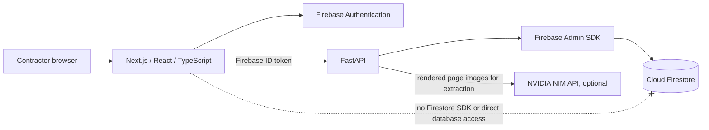

# Architecture

## Status

This describes the current code after Milestone 2 geometry support. The client can authenticate, create projects, upload and download reports, poll extraction/geometry jobs, review versioned measurements and geometry, configure material records, save estimate snapshots, and inspect either an approved project geometry or a clearly labelled demo roof. PyMuPDF adapters recover report-specific vector evidence, but the supplied Roofr and Roof Manager PDFs both remain `needs_review` because their constraints do not support approval. Quote PDF generation and production deployment automation are not implemented.

## System context

### Frontend

`apps/web` is a Next.js App Router application with strict TypeScript, Tailwind CSS, custom reusable CSS classes, Firebase JavaScript SDK **Auth only**, and a client-only React Three Fiber viewer. `lib/api.ts` adds a bearer token to API calls, refreshes once after 401, and signs out after a second 401. Multipart upload uses XMLHttpRequest for upload progress. The browser has no Firestore or file-storage import.

`GeometryReviewPanel` renders the stored report page as a private authenticated PNG, overlays page-coordinate polygons, and shows per-plane pitch/direction/area, assumptions, calibration diagnostics, and validation numbers. Contractors can trace/delete planes, drag/add/delete vertices, change pitch/direction/edge type and draw order, and confirm a scale from a known report dimension. A save creates an immutable revision; the server ignores client heights and recomputes topology, heights, and checks. Approval is gated by all checks, complete pitch/directions, a solved height system, explicit confirmation, and resolved stacking order. The client uses a selected approved geometry in the project 3D tab only; otherwise it loads the separately labelled demo asset. The demo remains generated from `fixtures/geometry/demo_roofr_83_rue_falardeau.json`, is never project-stored, and has estimated heights/wall depth.

`lib/roof/geometry.ts` contains typed schema/migration validation, coordinate mapping, polygon triangulation, wall-mesh construction, and validation helpers. The custom Node runner tests geometry mapping, shared-vertex consistency, area tolerance warnings, overlap order, version selection, and approval gating. For a demo fixture, these validate the static reference model; PDF-derived geometry is separately checked by the backend pipeline and API.

### Backend

`services/api/app/main.py` owns the HTTP API and authorization, including protected geometry reconstruction, version, page-image, edit, and approval routes. `config.py` validates environment settings at startup. `firebase.py` initializes/caches the Admin app and Firestore client, verifies Firebase ID tokens, and ensures a profile exists. `file_store.py` streams and verifies chunk documents. `extraction/pipeline.py` reads Roofr's selectable tables directly and sends rendered page images to NVIDIA NIM for model-backed extraction. `geometry/diagram_extract.py` reads page text/drawings/legend swatches; `roofr.py` and `roof_manager.py` adapt the supported vector formats; `calibrate.py` fits plan/sloped scales; `topology.py` polygonizes/snap-connects outlines; `heights.py` solves pitch gradients against eaves/shared edges; `validate.py` records numeric checks; `workflow.py` rebuilds edited versions and defines approval blockers. Geometry combines deterministic PDF evidence with optional NVIDIA coordinate candidates. `geometry_store.py` stores small geometry inline or large geometry as a Firestore chunk artifact. `estimation/engine.py` uses Decimal arithmetic for separate flat/pitched system lines, waste, coverage, package rounding, and price.

## Trust boundaries and authorization

1. The browser is untrusted. IDs, quantities, prices, paths, and displayed file names supplied by it are validated or treated as display-only.
2. Firebase Auth issues ID tokens. The API verifies each protected request with Firebase Admin and derives the UID from verified claims.
3. Before a project resource is touched, the API checks `projects/{projectId}.ownerUid`. Another user's resources resolve as 404. Material records are scoped beneath `users/{uid}`; job polls verify both the job owner and its referenced project owner.
4. Admin SDK calls bypass Security Rules. The backend's ownership checks are the application security boundary. Firestore rules deny all browser reads/writes as defense in depth.
5. NVIDIA API keys and production Firebase Admin credentials are backend-only. Local Firestore emulator mode uses anonymous credentials only for emulator traffic. PDF pages are rendered to temporary PNG data URLs for NVIDIA; application persistence is Firestore chunks. Temporary local files are deleted.

Health/readiness routes are unauthenticated. API error bodies are sanitized and stable; unexpected exception logs include the exception type but not the exception message, PDF content, tokens, or credentials.

## Firestore and files

Firestore is the only persistent application store. See [DATA_MODEL.md](docs/DATA_MODEL.md) for collections. A report or artifact parent stores metadata; its `{parent}/chunks/{000000...}` subcollection stores up to 512 KiB of bytes per document and a per-chunk SHA-256. Batches default to 8 chunks (about 4 MiB raw) and config rejects a configured raw payload above 9 MiB. Chunk IDs are deterministic and writes are retryable/idempotent. Reads use numeric point reads, verify contiguous indexes and chunk hashes, check size and full-file SHA-256, then stream through a private temp file. The upload and artifact limit defaults to 20 MiB.

The chunk field is excluded from single-field indexing. Firestore's documented maximum document size is 1 MiB and maximum API request size is 10 MiB; batched writes allow up to 500 operations. This implementation uses much smaller batches to leave request overhead margin. See [Firestore quotas](https://firebase.google.com/docs/firestore/quotas) and [batched writes](https://firebase.google.com/docs/firestore/manage-data/transactions). Chunked Firestore storage incurs a read/write/delete per chunk and higher latency than object storage. It is intentionally used because Firestore-only storage is the project constraint.

## Jobs and failure behavior

Job documents are durable in `jobs/{jobId}`. Execution uses FastAPI background tasks and a process-local bounded semaphore; the synchronous NVIDIA call runs in the framework's worker thread. Retries for transient NVIDIA errors and malformed JSON are bounded. On API startup, old `running` jobs are marked failed with a retry message. This is not a distributed queue: a single API process is the intended local setup; multiple instances could duplicate work or lose queued tasks. Production scale requires a durable worker/lease model while retaining Firestore as the data store.

Upload failure removes partial chunks and marks the report failed. Cleanup can be run with `python3.14 scripts/sweep_uploads.py` after dependencies and Admin credentials are configured. Report and project deletion mark file parents deleting, remove chunks in bounded batches, verify no chunk indexes remain, and then remove parent documents. Local scratch files are cleaned in `finally` blocks or after streamed responses.

## Geometry recovery, review, and approval

Geometry reconstruction is a separate persistent job. The worker verifies the report's Firestore chunks, reconstructs a temporary PDF, runs the format adapter, and saves diagnostics and a `needs_review` geometry version. Geometry versions store source report/measurement IDs, source, confidence, schema version, estimated-height flag, page-coordinate source facets, page calibration hypotheses/residuals, validation results, and optional canonical geometry inline or as a chunked artifact. The geometry schema remains version 1.1; the Milestone 1 demo fixture still loads through the same TypeScript schema/migration helper.

Roofr uses vector diagram, length, area, and pitch/direction pages. Roof Manager uses its page-local legend, page-3 vectors, report dimensions, and aggregate area data. The adapters associate labels by page position, register pages by outline bounds, and compare plan and sloped length scale hypotheses. A scale is not accepted as geometry proof: facet area, edge-class totals, pitch gradients, shared edge constraints, plane count, and overlaps remain separate checks. NVIDIA points remain candidates and do not establish validated scale. If information is missing, the status stays `needs_review` and the user must supply it in the 2D editor.

The PUT path derives a new manual revision from the immutable source PDF and user page-coordinate edits. The API validates page bounds and IDs, re-runs topology, height solving, overlap checks, and area/pitch/edge validation, then moves the project pointer transactionally with optimistic concurrency. Approved versions are not mutated. Approval checks run again on the server and require explicit confirmation. The current Roofr report creates a six-plane height candidate but has two missing arrows and contradictory shared-edge constraints, while its 18/12 SF source facets remain in the evidence panel. The Roof Manager report creates 21 candidate outlines versus 31 reported facets and no 3D candidate. Their actual scale/area/edge results are in [PDF_ANALYSIS.md](docs/PDF_ANALYSIS.md).

Absolute eave height, ground elevation, and wall depth are not measured by the reports. A solved mesh uses a relative lowest-eave datum; wall depth and heights are marked estimated in the UI. Reconstructed coordinate surfaces are only shown in the project viewer after explicit approval. The demo remains available for visualizer interaction and is labelled separately.

## Estimation and money

Inputs and calculations use `Decimal`; persisted money uses decimal strings. Net pitched and flat quantities are multiplied by their own waste factors exactly once. Roofr's waste table is preserved as a reference by roof type, not used as an extra multiplier. Unit conversions are restricted to explicit area/length conversions. Configured roll dimensions and lap widths reduce effective flat-system coverage before purchase rounding. Saved line items snapshot source, calculated, final, and manually overridden quantities, system, unit price, waste assumptions, calculation inputs, warnings, and line total. A later material edit does not mutate an existing estimate. Tax and markup values are configurable defaults, not legal or jurisdictional guidance.

## Configuration and operations

`app/config.py` is the backend settings source; `.env.example` documents every supported setting. Frontend Firebase and API values are public `NEXT_PUBLIC_*` variables in `apps/web/.env.local`. Production rejects demo project IDs and emulator endpoints and requires explicit, non-wildcard CORS origins. See the README table for defaults and sensitivity.

Implemented safeguards include bounded input sizes/chunks, checksum validation, PDF magic/open/encryption/page checks, content-disposition filename sanitization, private no-store file downloads, bounded retries, CORS origin validation, auth refresh, ownership checks, and generic server errors. Outstanding production work includes rate limiting, reverse-proxy body/time limits, TLS, production credential and secret management, structured monitoring/alerts, backup/restore verification, deployment automation, security review, and multi-instance job execution.

## Implemented versus planned

- **Implemented:** Firebase Auth client/server token flow; Firestore-only server persistence; deny-all rules; chunked report/artifact file helper; project/report API; Roofr direct-table parser plus NVIDIA NIM extraction; normalized mixed-roof measurements and version review; material catalogue; Decimal estimator with explicit flat-system configuration; PDF geometry adapters, calibration, topology/height checks, geometry jobs, versioned review/edit/approval API, page-image rendering, manual trace UI, and an R3F viewer that uses approved geometry or a separately labelled demo.
- **Not available from current PDFs:** an approved customer roof model. Roofr has partial vector evidence and unresolved directions/height conflicts. Roof Manager has insufficient plane outlines and no plane pitch/direction data; it remains a manual tracing job. No automatic path invents missing coordinates or heights.
- **Not implemented:** persisted estimate revisions, quote PDF generation, chunked quote artifacts, and quote download routes. The Quote tab is a clear placeholder.
