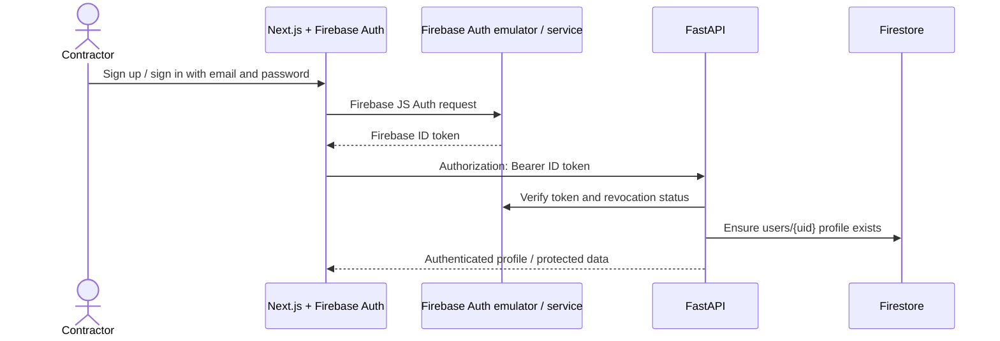

# User and system flows

Solid arrows and route names below describe implemented behavior. Dashed boxes are intentionally demo-only or deferred to Milestone 3.

## Sign-up and sign-in



The browser uses Firebase Authentication only. It never connects to Firestore. API requests that receive 401 refresh the ID token once; a second 401 signs the user out.

## Project and PDF upload

```mermaid
sequenceDiagram
    actor Contractor
    participant Browser
    participant API as FastAPI
    participant DB as Firestore
    Contractor->>Browser: Create project
    Browser->>API: POST /api/projects (Bearer token)
    API->>DB: Verify ownership context, create project
    Contractor->>Browser: Select Roof Manager PDF
    Browser->>API: Multipart upload via XHR (progress)
    API->>DB: Check project ownership
    API->>API: Bounded copy to private temp file, hash, PDF validation
    API->>DB: Create deterministic report ID from PDF SHA-256
    loop chunks in bounded batches
        API->>DB: reports/{id}/chunks/000000… (bytes + checksum)
    end
    API->>DB: Verify chunk count; set report complete
    API-->>Browser: Report ID + persistent extraction job ID
```

An identical complete PDF is returned as a duplicate. A fresh upload collision returns 409. Stale or failed partial upload chunks are cleaned before an upload takes over. `python3.14 scripts/sweep_uploads.py` can sweep stale `uploading` reports. Local disk is scratch only and is removed after storage.

## Extraction and measurement review

```mermaid
sequenceDiagram
    participant API as FastAPI
    participant DB as Firestore
    participant NVIDIA as NVIDIA NIM
    participant Browser
    API->>DB: Create queued jobs/{jobId}
    API-->>Browser: Return job ID without holding request for model extraction
    API->>DB: Reassemble report chunks and verify full SHA-256
    API->>API: Inspect PDF text, page size, vector paths, and images
    alt Roofr report with selectable measurement tables
        API->>API: Parse separate flat / pitched areas, pitch groups, edges, and waste tables
    else Other supported measurement PDF
        API->>API: Render PDF pages to PNG images
        API->>NVIDIA: Image parts + extraction-only prompt (if key configured)
        NVIDIA-->>API: JSON response
    end
    API->>API: Parse and validate typed report envelope; normalize tagged quantities
    API->>DB: Store immutable raw JSON artifact and measurement version
    API->>DB: Transactionally update current measurement pointer
    Browser->>API: GET /api/jobs/{jobId} (poll)
    Browser->>API: GET /api/projects/{id}/measurements
    Browser->>API: PUT reviewed values + expected version ID
    API->>DB: Save a new user_reviewed version and update pointer transactionally
```

The raw extraction JSON is retained as a Firestore artifact. A measurement can be `measured`, `zero`, `not_surveyed`, `unknown`, or `not_reported`. Roofr values are read directly from selectable text; its flat/pitched totals, aggregate pitch groups, eight rounded facet-area labels, and separate waste tables remain distinct. Source values are preserved in version provenance. Consistency checks create warnings; they do not rewrite the source. Roofr scalar extraction does not require NVIDIA; other supported PDFs use the configured NVIDIA path. Geometry reconstruction can also request NVIDIA diagram points. The checked-in `roof_data.json` can be normalized locally without a provider call.

## Geometry and 3D

```mermaid
    PDF[Stored PDF chunks] --> Reassemble[Verify chunks + SHA-256 to private temp file]
    Reassemble --> Adapter{Supported vector adapter?}
    Adapter -->|Roofr, 8 pages| Roofr[Diagram / lengths / area / pitch vectors]
    Adapter -->|Roof Manager, 5 pages| RM[Legend-filtered page 3 vectors + report totals]
    Adapter -->|Raster or unknown| Unsupported[unsupported + reason]
    Roofr --> Calibration[Robust plan vs sloped scale fits]
    RM --> Calibration
    Calibration --> Topology[Polygonize / register / key labels + arrows]
    Topology --> Solve[Shared-edge height solve + numeric validation]
    Solve --> Candidate[Firestore geometry version: needs_review]
    Unsupported --> Candidate
    Candidate --> Review[PDF page overlay + edit pitch / direction / vertices / stack]
    Review --> Save[PUT: new version; server rebuilds + revalidates]
    Save --> Gate{All checks pass + explicit confirmation?}
    Gate -->|yes| Approve[POST approve: immutable approved version]
    Gate -->|no| Review
    Approve --> Customer[Approved geometry in project 3D tab]
    Demo[Static six-surface demo fixture] -. "clearly labelled fallback" .-> Viewer[Client-only React Three Fiber viewer]
    Customer --> Viewer
    Materials[Per-plane material / colour / texture] --> Viewer
    Materials --> Project[Save materialSelections on project]
```

Implemented geometry flow: `POST /geometry/reconstruct` verifies project/report ownership, creates a version and persistent geometry job, and runs the PDF adapter in a bounded in-process task. Page coordinates are calibrated from dimension labels; the analysis stores label matches, residuals, hypotheses, and checks. Reconstruction always ends in `needs_review` or `failed`, never `approved`. `GET /geometry` and `/geometry/versions` return the current or historical owned version; `/geometry/page-image` renders the selected report's page to a transient PNG. `PUT /geometry` accepts reviewed page-coordinate edits and creates a new version. The server rebuilds topology and heights, then re-runs checks. `POST /geometry/approve` requires explicit confirmation, all checks passing, complete plane pitch/direction data, a solved height surface, and no unresolved overlap order.

Roofr currently yields eight matched area labels and pitch labels, six directions, and six candidate planes. Its scale and facet-area checks pass, but two arrows are missing and shared-edge height constraints conflict, so the candidate remains review-only. Roof Manager yields 21 closed outline candidates versus 31 reported planes; its dimension fit and eave/hip/rake totals warn, and it has no per-plane pitch/direction. It remains review-only and requires tracing, per-plane pitch/direction, and lower-eave constraints. The UI can edit outlines, add/delete/trace planes, edit pitch/direction and edge types, change draw order, and confirm a manual scale; the server never accepts client heights.

The demo fixture `fixtures/geometry/demo_roofr_83_rue_falardeau.json` remains a static, six-surface DEMO port of `roof3d.html`: four pitched faces, two drained flat faces, shared vertices/edges, estimated wall loops, overlap witnesses, and page compass. `predev`, `prebuild`, and `prestart` copy it to a generated same-origin public asset; it is never saved as customer geometry. R3F supports orbit, zoom, pan, reset, 3D and Diagram-oriented top camera presets, selectable/highlighted surfaces, edge outlines, per-plane material/colour and procedural tiled previews. Appearance selections are saved to the project independently of geometry. The viewer uses an approved project geometry only; otherwise it clearly shows the demo. All absolute heights and wall depth are estimates. Synthetic vector fixtures test polygon recovery, calibration, pitch/direction and height solving; real-PDF golden tests report failures and warnings without forcing a pass.

## Estimate

```mermaid
flowchart LR
    Review[Reviewed net quantities: 643 SF pitched + 515 SF flat] --> Inputs[Editable separate roof-system lines]
    Catalog[User material catalogue / placeholder rates] --> Inputs
    Inputs --> API[POST /api/projects/{id}/estimates]
    API --> Engine[Decimal calculation: waste once, conversion, package rounding, report comparison, markup, tax]
    Engine --> Snapshot[Saved estimate + line item snapshots]
    Snapshot --> UI[Itemized estimate and warnings]
    Snapshot -. "Milestone 3" .-> Quote[PDF quote artifact / download]
```

The estimate engine is backend-only. Roofr source “with waste” values remain separate comparison references; the app starts from pitched/flat net quantities and applies each selected waste factor once. Flat roofing requires an explicit EPDM/TPO/PVC/modified-bitumen/other system selection and configurable coverage, package, laps, and rate; asphalt shingles are rejected for flat lines. Source quantity differences beyond one square foot are warning-level. Incomplete system, waste, coverage, or package assumptions keep a line provisional unless a final quantity override is supplied. The UI does not yet populate estimate lines from the catalogue. Estimate revisions and PDF quote generation are not implemented; the Quote tab is an explicit placeholder.

## Deletion and cleanup

```mermaid
sequenceDiagram
    actor Contractor
    participant API as FastAPI
    participant DB as Firestore
    Contractor->>API: DELETE report/project (Bearer token)
    API->>DB: Verify ownership first
    API->>DB: Mark report/artifact deleting
    loop bounded batches
        API->>DB: Delete all chunk documents
    end
    API->>DB: Verify no chunk indexes remain; delete parent records
    API-->>Contractor: 204
```

Project deletion also removes estimate line-item subcollections and project jobs. Stale partial uploads are cleaned by the management command; there is no scheduler configured.
